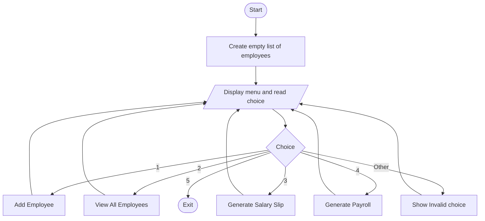
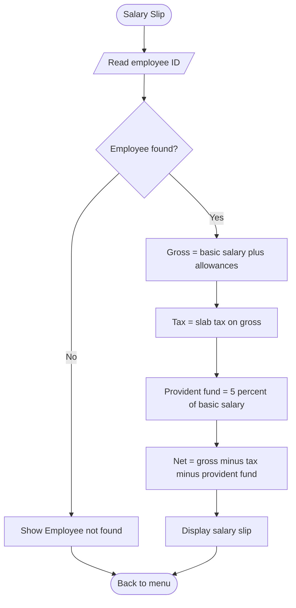
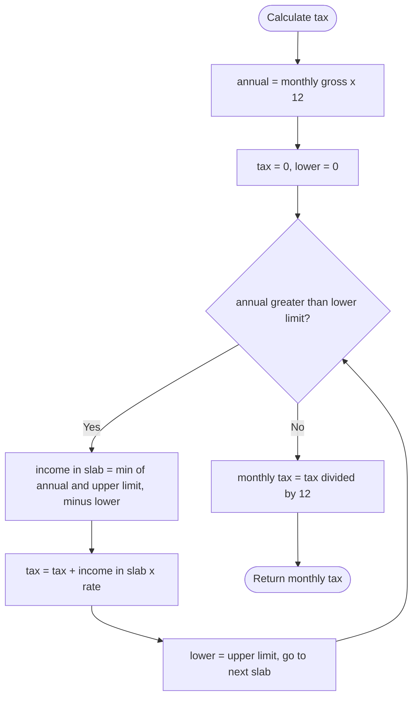

# Employee Payroll System

A console-based Java application that calculates and manages employee salaries: it applies tax and deductions, generates salary slips and produces payroll for all employees.

| | |
|---|---|
| **Developer** | Aliyan Ahmad |
| **Program** | Auspify Java Developer Internship |
| **Task** | Task 5 (Advanced) - Employee Payroll System |
| **Language** | Java (JDK 8 or higher) |
| **Storage** | `ArrayList<Employee>` (in-memory) |
| **GitHub Repository** | https://github.com/codebyaliyan/payroll-system |

---

## 1. Objective
Create a system to calculate and manage employee salaries, covering salary calculation, tax deduction and payroll generation, while demonstrating OOP, logic implementation and data processing.

## 2. Features

| # | Feature | Description |
|---|---|---|
| 1 | Add Employee | Stores ID, name, basic salary and allowances; duplicate IDs are rejected |
| 2 | View All Employees | Table of all employees with their gross salary |
| 3 | Generate Salary Slip | Detailed slip for one employee (earnings, tax, deductions, net salary) |
| 4 | Generate Payroll | Salary figures for all employees with totals |
| 5 | Exit | Closes the program |

## 3. Requirements Mapping

| Task Step | Requirement | Implementation |
|---|---|---|
| Step 1 | Create Employee class with salary details | `Employee.java` (ID, name, basic salary, allowances) |
| Step 2 | Add salary calculation logic | `calculateGrossSalary()` and `calculateNetSalary()` |
| Step 3 | Apply tax and deductions | `calculateTax()`, `calculateProvidentFund()`, `calculateTotalDeductions()` |
| Step 4 | Generate salary slips | `printSalarySlip()` and `generatePayroll()` |
| Step 5 | Store employee records | `ArrayList<Employee>` in `PayrollSystem.java` |

| Key Feature | Where |
|---|---|
| Salary Calculation | `calculateGrossSalary()`, `calculateNetSalary()` |
| Tax Deduction | `calculateTax()` |
| Payroll Generation | Menu option 4 (`generatePayroll()`) |

## 4. Payroll Rules

```
gross salary     = basic salary + allowances
income tax       = progressive slab tax on the gross salary
provident fund   = 5% of the basic salary
total deductions = income tax + provident fund
net salary       = gross salary - total deductions
```

**Income tax (progressive slabs)**

Annual income = monthly gross x 12. Only the part of the income that falls inside a slab is taxed at that slab's rate. Monthly tax = annual tax / 12.

| Annual income slab | Rate |
|---|---|
| Up to 600,000 | 0% |
| 600,000 to 1,200,000 | 5% |
| 1,200,000 to 2,200,000 | 15% |
| 2,200,000 to 3,200,000 | 25% |
| 3,200,000 to 4,100,000 | 30% |
| Above 4,100,000 | 35% |

> **Note:** these slabs are **illustrative sample values for this exercise, not official tax law.** They are defined in one place (`SLAB_LIMITS` and `SLAB_RATES` in `PayrollSystem.java`) so they are easy to change.

**Worked example (Sara Khan: basic 150,000, allowances 50,000)**

Gross = 200,000 per month = 2,400,000 per year.
Annual tax = 600,000 x 5% (30,000) + 1,000,000 x 15% (150,000) + 200,000 x 25% (50,000) = 230,000.
Monthly tax = 230,000 / 12 = **19,166.67**. Provident fund = 5% x 150,000 = **7,500.00**.
Net salary = 200,000 - 19,166.67 - 7,500 = **173,333.33**.

**Validation rules**

| Rule | Enforced in |
|---|---|
| Employee ID greater than zero and unique | `addEmployee()` and the `Employee` constructor |
| Name not empty, at most 25 characters | `Employee` constructor and `readName()` |
| Basic salary greater than zero | `Employee` constructor and `readAmount()` |
| Allowances zero or more | `Employee` constructor and `readAmount()` |
| Invalid or non-numeric input is re-asked, never crashes | Input helper functions in `PayrollSystem` |

## 5. Skills Demonstrated

| Skill (from the task sheet) | How it is shown |
|---|---|
| **Java OOP Advanced Concepts** | `Employee` class with encapsulation, immutability (all fields `final`), constructor validation and exceptions |
| **Logic Implementation** | Progressive slab tax, gross to net salary calculation, rounding to 2 decimals |
| **Data Processing** | `ArrayList` of employees, searching, looping, totals for the payroll, formatted tables |

## 6. Project Structure
```
Employee-Payroll-System/
|-- Employee.java        (the Employee class: salary details)
|-- PayrollSystem.java   (main class: menu, calculation functions, slips, payroll)
|-- README.md            (this document)
```

## 7. Functions in PayrollSystem

| Function | Purpose |
|---|---|
| `main()` / `menu()` | Program loop and menu |
| `addEmployee()` | Read and store a new employee |
| `viewEmployees()` | Show all employees in a table |
| `generateSalarySlip()` / `printSalarySlip()` | Find an employee and print the salary slip |
| `generatePayroll()` | Calculate and print pay for all employees, with totals |
| `calculateGrossSalary()` | Basic salary + allowances |
| `calculateTax()` | Progressive slab income tax |
| `calculateProvidentFund()` | 5% of basic salary |
| `calculateTotalDeductions()` | Tax + provident fund |
| `calculateNetSalary()` | Gross - total deductions |
| `findById()` | Look up an employee by ID |
| `readInt()` / `readName()` / `readAmount()` | Validated input helpers |

**Design decisions**
- **One class only.** `Employee` is the only class, because the task asks for one. The processing is done by small functions, each with one job.
- **`Employee` is immutable.** Data is validated once in the constructor, so an invalid employee can never exist.
- **Calculation functions are separate from printing.** The calculations can be reused by the slip and the payroll without repeating the formulas.
- **All input uses `nextLine()` plus manual parsing,** which avoids the Scanner newline bug.
- **Every money value is rounded to 2 decimals** at each step, so slips always add up.

## 8. Pseudocode

```
START
  CREATE empty list employees

  REPEAT
    DISPLAY menu
    READ choice

    CASE 1 - ADD EMPLOYEE:
        READ id
        IF id <= 0 OR an employee with this id exists THEN
            DISPLAY error
        ELSE
            READ name (not empty, max 25 characters)
            READ basic salary (greater than zero)
            READ allowances (zero or more)
            CREATE Employee and ADD to employees
            DISPLAY "Employee added successfully"

    CASE 2 - VIEW ALL:
        IF employees is empty THEN
            DISPLAY "No employees found"
        ELSE
            FOR EACH employee: DISPLAY id, name, basic, allowances, gross

    CASE 3 - SALARY SLIP:
        READ id
        FIND employee by id
        IF not found THEN DISPLAY error
        ELSE PRINT SALARY SLIP(employee)

    CASE 4 - PAYROLL:
        IF employees is empty THEN
            DISPLAY "No employees found"
        ELSE
            FOR EACH employee
                gross = CALCULATE GROSS
                tax   = CALCULATE TAX(gross)
                fund  = CALCULATE PROVIDENT FUND
                net   = gross - (tax + fund)
                DISPLAY row; ADD to totals
            DISPLAY totals

    CASE 5 - EXIT:
        DISPLAY "Goodbye"; STOP loop

    OTHERWISE:
        DISPLAY "Invalid choice"
  UNTIL user chooses Exit
END

FUNCTION PRINT SALARY SLIP(employee):
    gross      = basic salary + allowances
    tax        = CALCULATE TAX(gross)
    fund       = basic salary x 5%
    deductions = tax + fund
    net        = gross - deductions
    DISPLAY earnings, deductions and net salary

FUNCTION CALCULATE TAX(monthlyGross):
    annual = monthlyGross x 12
    tax = 0; lower = 0
    FOR EACH slab (upperLimit, rate) IN order
        IF annual <= lower THEN STOP
        incomeInSlab = MIN(annual, upperLimit) - lower
        tax = tax + incomeInSlab x rate
        lower = upperLimit
    RETURN tax / 12
```

## 9. Flowcharts

### 9.1 Main program flow


### 9.2 Generate Salary Slip


### 9.3 Tax calculation


## 10. How to Compile and Run

```
javac Employee.java PayrollSystem.java
java PayrollSystem
```

## 11. Sample Output

```
===== EMPLOYEE PAYROLL SYSTEM =====
1. Add Employee
2. View All Employees
3. Generate Salary Slip
4. Generate Payroll (All Employees)
5. Exit
===================================
Enter your choice: 1
Enter Employee ID: 101
Enter Employee Name: Ali Raza
Enter Basic Salary (monthly): 60000
Enter Allowances (monthly, 0 if none): 20000
[SUCCESS] Employee added successfully.

Enter your choice: 2

| ID    | Name                      |  Basic Salary |   Allowances |  Gross Salary |
|-------|---------------------------|---------------|--------------|---------------|
| 101   | Ali Raza                  |      60000.00 |     20000.00 |      80000.00 |
| 102   | Sara Khan                 |     150000.00 |     50000.00 |     200000.00 |
| 103   | Bilal Ahmed               |      40000.00 |         0.00 |      40000.00 |
Total employees: 3

Enter your choice: 3
Enter Employee ID: 101

=======================================================
  SALARY SLIP - October 2026
=======================================================
  Employee ID   : 101
  Name          : Ali Raza
-------------------------------------------------------
  EARNINGS
    Basic Salary                               60000.00
    Allowances                                 20000.00
  Gross Salary                                 80000.00
-------------------------------------------------------
  DEDUCTIONS
    Income Tax                                  1500.00
    Provident Fund                              3000.00
  Total Deductions                              4500.00
-------------------------------------------------------
  NET SALARY                                   75500.00
=======================================================
  Generated on: 2026-10-10 12:42:04

Enter your choice: 4

PAYROLL - October 2026
| ID    | Name                      |        Gross |          Tax | Provident Fund |          Net |
|-------|---------------------------|--------------|--------------|----------------|--------------|
| 101   | Ali Raza                  |     80000.00 |      1500.00 |        3000.00 |     75500.00 |
| 102   | Sara Khan                 |    200000.00 |     19166.67 |        7500.00 |    173333.33 |
| 103   | Bilal Ahmed               |     40000.00 |         0.00 |        2000.00 |     38000.00 |
|-------|---------------------------|--------------|--------------|----------------|--------------|
|       | TOTAL                     |    320000.00 |     20666.67 |       12500.00 |    286833.33 |
Employees paid: 3
```

_Add your own screenshot here: ``_

## 12. Test Cases

| # | Feature | Input | Expected result |
|---|---|---|---|
| 1 | View | No employees yet | "No employees found." |
| 2 | Add | 101, Ali Raza, 60000, 20000 | "[SUCCESS] Employee added successfully." |
| 3 | Add | Same ID 101 again | "[ERROR] Employee with ID 101 already exists." |
| 4 | Add | ID 0 | "[ERROR] Employee ID must be greater than zero." |
| 5 | Add | ID abc | "Invalid input. Please enter a whole number.", asks again |
| 6 | Add | Empty name | "Name cannot be empty.", asks again |
| 7 | Add | Name longer than 25 characters | "Name cannot be longer than 25 characters.", asks again |
| 8 | Add | Salary abc | "Invalid input. Please enter a number.", asks again |
| 9 | Add | Salary 0 or -5 | "Value must be at least 0.01.", asks again |
| 10 | Add | Allowances -1 | "Value must be at least 0.00.", asks again |
| 11 | View | After adding employees | Table; gross = basic + allowances |
| 12 | Slip | 101 (60000 + 20000) | Gross 80000.00, tax 1500.00, provident fund 3000.00, net 75500.00 |
| 13 | Slip | 102 (150000 + 50000) | Gross 200000.00, tax 19166.67, provident fund 7500.00, net 173333.33 |
| 14 | Slip | 103 (40000 + 0) | Gross 40000.00, tax 0.00, provident fund 2000.00, net 38000.00 |
| 15 | Tax boundary | Basic 50000, allowances 0 | Tax 0.00 (annual 600,000 is exactly tax free), provident fund 2500.00, net 47500.00 |
| 16 | Tax slab | Basic 100000, allowances 0 | Tax 2500.00, provident fund 5000.00, net 92500.00 |
| 17 | Tax top slabs | Basic 400000, allowances 100000 | Tax 113750.00, provident fund 20000.00, net 366250.00 |
| 18 | Slip | ID 999 (not added) | "[ERROR] Employee 999 not found." |
| 19 | Slip | ID abc | "Invalid input. Please enter a whole number.", asks again |
| 20 | Payroll | No employees | "No employees found. Add employees first." |
| 21 | Payroll | Employees 101, 102, 103, 105 (400000 + 100000), 106 (50000 + 0) | Totals: gross 870000.00, tax 134416.67, provident fund 35000.00, net 700583.33 |
| 22 | Menu | abc | "Invalid input. Please enter a number." |
| 23 | Menu | 7 | "Invalid choice. Please enter a number from 1 to 5." |
| 24 | Menu | 5 | "Thank you for using the Employee Payroll System. Goodbye!" |
| 25 | End of input | Ctrl+Z (Windows) or Ctrl+D at a prompt | "Input closed. Exiting..." with no crash |

## 13. Known Limitations
- Data is stored in memory only and is lost when the program closes.
- Money is stored as `double` and rounded to 2 decimals. This is fine for learning; production payroll software uses `BigDecimal`.
- The tax slabs are illustrative samples, not official tax law.
- Salary slips are for the current month; there is no payroll history.
- Employee lookup is a linear scan, which is fine for small data sets.

## 14. Future Enhancements
- Save and load employees from a file or database (JDBC)
- Update and remove employees
- Different employee types (for example part-time or contract) using inheritance
- Bonuses, overtime and other deductions
- Unit tests with JUnit
